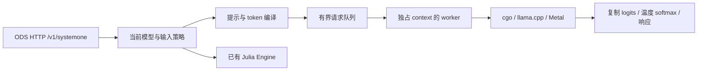

# OpenDecisionServer 接入 Chinese Decision / llama.cpp 的设计与验证

日期：2026-10-27。范围是接入设计与独立原生验证，不是生产后端交付。用户优先准确率；部署为 Apple Silicon，语音决策目标是请求 p95 ≤100 ms；纯拼音不是重点。默认 Julia 服务本次不变。

## 决策摘要

建议由 ODS 承担 HTTP、验证、排队和响应，由 cgo 直接调用固定版本的 llama.cpp，继续使用已经实测的 Chinese Decision 2B Q8_0 和 Metal。移除 Python 后，模型前向仍是同一引擎；不能由语言替换推断明显提速。真正值得验证的优化是把独立问题放进不同 sequence，一次提交给引擎。

选择直接 C API 的原因是能读取指定候选字母的原始 logits、明确控制混合架构状态清理，并实验多序列批处理。保留 Python 服务作为迁移期参考更容易，但仍有第二进程和两套生命周期；转接通用生成 HTTP 接口还需核实原始候选 logits 的能力。当前不增加这两个路径。此处是工程选择，不是用户指定的实现细节。

本次证据与复现见 [原生验证报告](../../../tests/evaluation/results/2026-10-27-native-validation/README.md)。达到哪些一致性和延迟指标，以该报告为准；未通过的优化不得作为默认能力。

本次串行原生路径通过原 989 条答案与概率一致性检查；多序列虽无 winner 变化，但概率差超过预设 1e-4，且三问 p95 约 156/257/432ms，比同程序串行约 141/253/390ms 更慢。因此当前可继续的是串行接入，批处理仅保留为后续研究，不作为首版生产选项。该结果不证明所有参数配置均无优化空间。

## 已核实的事实

- 当前 ODS 为 Go HTTP + ONNX Runtime，模型路由、响应模型名和 `/v1/models` 均写死 Julia；`Engine.Decide` 已提供多题输入边界。[service.go](../../../internal/decision/service.go#L71)、[HTTP](../../../internal/api/http/server.go#L38)、[接口](../../../internal/decision/types.go#L37)
- 作者 Python 服务负责提示编译、HF/GGUF token 一致性检查、候选字母 logits、温度归一化和响应。单题前清空状态，当前服务逐题串行。[固定版 processing.py](https://github.com/yanqiangmiffy/chinese-decision/blob/9bf28a803b7e3474c52f030bc72618656c054726/decision/processing.py#L47)、[固定版 backends.py](https://github.com/yanqiangmiffy/chinese-decision/blob/9bf28a803b7e3474c52f030bc72618656c054726/decision/serving/backends.py#L48)、[Metal 补丁](../../../tests/evaluation/results/2026-10-27-chinese-decision-2b/metal-backend.patch)
- 本机已固定模型权重、配置和代码，历史准确率为自建集 435/504、外部集 366/485；不是实际线上准确率保证。[模型清单](../../../tests/evaluation/results/2026-10-27-chinese-decision-2b/model-manifest.json)、[历史评测](../../../tests/evaluation/results/2026-10-27-chinese-decision-2b/README.md)
- 本次使用 llama-cpp-python 0.3.36 所带的原生库和同一源包头文件，不用网上 master 头文件拼接旧动态库。`llama_batch`、序列和末位 logits 是官方公开 API；API 行为须以固定源码为准。[官方批处理示例](https://github.com/ggml-org/llama.cpp/blob/master/examples/batched/batched.cpp)、[本地固定头文件](../../../dist/llama-cpp-python-cpu/vendor/llama.cpp/include/llama.h#L365)、[运行来源哈希](../../../tests/evaluation/results/2026-10-27-native-validation/metadata.json)

## 进程、接口与模型选择

第一阶段一个进程只加载一个选定引擎；新启动选项为 `-engine julia|chinese-decision`，默认 `julia`。保留已有 Julia 参数。Chinese Decision 增加模型文件、native 库目录、配置目录参数，参数最终命名可由实现者决定。A/B 测试启动两个端口，不在一个 16 GiB 进程中同时常驻两个后端。

建立单一模型描述对象，包含 canonical ID、别名、输入策略、引擎和 readiness。Service 与 `/v1/models` 共用它；仅列出当前加载成功的模型，非当前模型返回 unknown model，不自动降级到 Julia。Chinese Decision canonical ID 为 `chinese-decision-2b`，首版不添加含糊的 `latest` 别名。Julia canonical ID 和现有别名保持不变。

保留 `Engine.Decide(ctx, []Input) ([]Result,error)`，输出顺序与输入一致。生命周期由 runtime 对象持有：初始化、warmup、停止接收、等待 worker、关闭；不强迫 Julia Engine 实现原生队列。输入新增原始 instructions 字段，不从已排序或已转 float64 的 `Question` 恢复内容。

## 输入与输出契约

Chinese Decision 首版支持 choice、noul、score，候选数 2–26；输入最大 16,384 tokens，包含完整 chat template。超过限制返回验证错误，不静默截断、改写问题或减少历史。26 是模型交付上限，训练覆盖 2–16；超过 16 的准确率不作保证。Julia 使用现有规则。

按作者 `options_for` 和 `compile_prompt` 行为建立独立编码器：保留选项和问题的输入顺序；noul 固定 false/true 顺序，缺描述时为“否/是”；显式 null 描述是字符串 `null`，空描述保留空串；缺失或 null instructions 拒绝。拒绝重复 JSON key，以消除歧义，作为 ODS 明确约束；此点不声称与 Python 默默覆盖重复 key 相同。

结构化 state、instructions 和描述不能走当前 `ContentText` 的 map/float64 重编码。实现一个保序 JSON AST：对象为有序键值对，整数保持精度，浮点按 Python JSON 的有限 float 行为规范化，字符串按 `ensure_ascii=False`、无 HTML 转义、紧凑分隔符输出；拒绝非有限或无法按该契约表示的数值。整数与浮点类型分别保留，`1.0`、`1e-7`、`-0.0` 都需与 Python 参考对齐。Go `encoding/json` 的默认 float 格式不足以直接作等价实现。实现者可以选专用序列化实现，但必须用 Python goldens 证明，不可只做 `json.Compact` 或 `UseNumber` 后原样输出数值。

单 user 消息，`enable_thinking=False`、`add_generation_prompt=True`；模板与 tokenizer 随模型一起固定哈希。启动时检查 A–Z 各为一个 token，HF 参考 token 与 GGUF token 一致；不调用文本生成或采样。读原生 float32 logits，提升为 float64 后除以 `decision_config.json` 中正且有限的 temperature（当前 1.074872374534607），仅在有效候选中做稳定 softmax，拒绝 NaN/Inf。不得沿用 Julia 无温度 softmax。

Chinese Decision 响应沿用作者字段：每题有 probabilities、confidence；noul 返回 P(true)，choice 返回最大概率的 key，score 返回期望等级。概率并列时选原候选顺序的第一项；score 分类评测看概率 argmax。score 的 legend **保留原始 criteria JSON**，以 ODS 现有契约及作者 checker 为准：作者 `build_answer` 对结构化 legend 会转成字符串，二者不一致，本设计明确保留原值。模型名返回 canonical ID，usage 为实际输入 token 总和、输出 token 0；错误时不返回部分成功的 answers。Julia 响应不改。[作者 response/checker](https://github.com/yanqiangmiffy/chinese-decision/blob/9bf28a803b7e3474c52f030bc72618656c054726/decision/serving/api.py#L5)

## 原生所有权、取消与关闭

模型权重只读，首版只建一个 context，由一个 worker 独占。HTTP goroutine 不直接 reset/decode/读取 logits。C 侧持有 model/context/batch 内存，不保存 Go 指针；Go 传入的标量切片只在同步调用期间借用。读取 logits 后立即复制候选值，下一次 decode 前不保留引擎内部指针。

每个独立作业前 `llama_memory_clear(llama_get_memory(ctx), true)`，同时清理 attention 与 recurrent 状态；首版不做跨请求 prefix cache，也不复用上一次请求的 recurrent 尾状态。native 返回非零、无 logits 或非有限值时，先 synchronize、清理，再报告错误并丢弃整个作业结果；无法确认可复用时卸下 readiness 并终止该 worker，进程由 supervisor 重启。

Metal 的 abort callback 在固定头文件中只声明支持 CPU，不能承诺立即中断 GPU。排队时取消可移除任务；运行时取消仅让客户端停止等待，worker 仍持有所有 native 资源，等待 GPU 完成后丢弃结果、清理才复用。结果通道有容量，不能因接收者离开阻塞 worker。

关闭顺序是 readiness=false → 停止 admission → 取消排队任务 → HTTP shutdown → join 所有 native worker → 释放 batch/context/model → backend_free。即使 HTTP shutdown 超时，也不得立即执行 free；应用继续等待 native 结束，外部 supervisor 可按退出期限终止整个进程，不能在同一进程制造 use-after-free。当前 `main.go` 在 HTTP 超时后会走 engine.Close，接入时必须一并修正。[现有生命周期](../../../cmd/ods/main.go#L90)、[固定头文件取消与失败说明](../../../dist/llama-cpp-python-cpu/vendor/llama.cpp/include/llama.h#L398)

## 排队和批处理策略

先交付 batch=1 的可验证串行实现，再把通过一致性门槛的批处理做成显式选项。本次 batch 未通过，下述批处理部分是后续候选设计，不在首版启用。HTTP request admission 与 context 并发是两层概念，不能把当前 max-runs=4 转成 4 个线程同时操作一个 context。

建议初始限制：body 1 MiB、每请求最多 64 题、排队请求最多 32、排队已编译 tokens 总和最多 65,536；以完整请求为单位原子验收，超限返回 429，不执行一半。编译前有界 admission；编译后原子预留 token 配额，取消和结束仅释放一次。默认不人为等待凑批（batch wait=0）；采用请求间 round-robin，每轮从每请求最多取一题，已有等待者优先，保持结果索引以恢复每请求题序。一次批处理最多 4 个独立问题、合计最多 8,192 tokens；单题超过批预算时独立运行并分块 decode，不截断。上述数值是本次工程建议，可经资源和负载评测调整，不是已证明的容量上限。

真实多序列 batch 给每题不同的 sequence ID，position 各自从 0 开始，每 token 的 n_seq_id=1；仅每题最后 token 请求 logits。`llama_batch_init(total,0,1)` 的第三个参数是每 token 最多关联多少序列，并非 batch 题数。读取结果用该题最后 token 在**原 batch 中的位置**，不是 sequence ID 或压缩后的输出行号。混合长短序列交由本版本 splitter 处理，不手动 padding。

batch context `n_seq_max=4`；固定默认 kv_unified=false 时，要保留每序列 16,384 容量，申请 `n_ctx=65,536` 并核实 `llama_n_ctx_seq`。初始 logical n_batch=8192，physical n_ubatch=512、4 CPU threads、全层 Metal、flash attention disabled，与参考行为尽量一致。单序列基线为 n_ctx16384/n_batch512/n_ubatch512。不能仅检查 n_ctx 或只计 decode 返回时间：getter 会同步 GPU，计时必须包含读取和复制。[固定 API 与 getter](../../../dist/llama-cpp-python-cpu/vendor/llama.cpp/include/llama.h#L966)、[原生验证源码](../../../tests/evaluation/native_probe/main.go)

## 就绪、资源与运维

分发 native 库及其依赖时固定来源、哈希与 ABI 头文件；首版只承诺本机 darwin/arm64 Metal。Linux/CUDA 为后续独立构建与验证，不从本次结果外推。默认构建不得依赖本机 dist 目录；原生后端应使用明确 build tag / 独立发行构建，并在缺库或 Metal 不可用时启动失败，禁止不告知地回落 CPU。

模型、温度、模板、候选 token 检查、context 初始化和 warmup 全部通过后才 ready。每次启动记录实际 GPU offload、ctx/seq/batch/ubatch、权重/配置/原生库哈希。指标至少包含排队时间、提示/分词时间、同步推理时间、响应时间、batch 题数/tokens、拒绝/取消/错误计数、GPU/进程内存。禁用文本请求内容的默认日志。

## 实施顺序与验收

1. 固化 Python 兼容性 goldens，补全上述有序对象、大整数、浮点、转义、null/空选项、2/26 候选、缺失字段、16,384 token 边界的用例。当前字符串数据不能证明结构化 API 全面兼容。
2. 完成 model descriptor、model-specific 输入策略和串行 native runtime，保留所有 Julia 官方 parity 和现有 API 测试；增加真实 Metal A/B/A、取消、decode 失败、关闭时 drain 的验证。无 GPU 的 CI 做纯编码与 fake worker 生命周期测试，Metal 验收在目标设备跑。
3. 对固定 989 条比较 Python/Go 的提示 bytes、token IDs、候选次序、概率及所有响应字段。预设门槛：100% winner 一致、每候选概率绝对差 ≤1e-4、无准确率下降；新增 API 边界用例也必须通过。score 期望和 legend 以本设计契约单独校验。
4. 只有上述通过后才启用原生批处理候选；混合长度、不同题型、重复输入、顺序置换和前后请求状态隔离须同样通过。若 batch 数值变化超过门槛，保持默认串行，记录失败，不在测试集上调温度或提示来掩盖差异。
5. 在 ODS HTTP 集成后重跑现有 18 条语音性能 workload × 1/4 clients × 120 requests/group，6 次 warmup；计时包含完整响应读取与验证，超时、拒绝和错误单列且不能通过丢弃慢请求宣称满足预算。再加 ASR/TTS 共享 GPU 的真实业务流量。只有该结果才能评价端到端 p95≤100ms。

本次只完成设计与原生可行性验证；生产 parser、model registry、调度/取消/关闭实现和 HTTP 端到端验收属于下一阶段。本机 native 内核结果不能替代这些验收。
