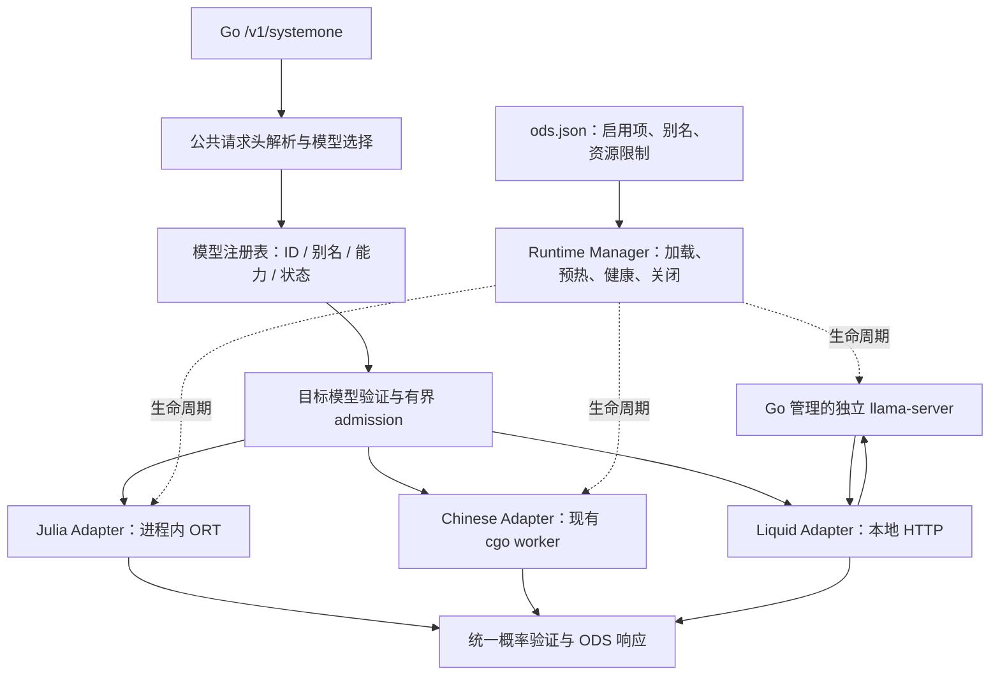

# Open Decision Server：配置驱动的多模型接入与切换

状态：**原混合接入方案已撤回，仅保留为历史设计记录，不作为实施依据。** 用户已明确要求统一 Go＋cgo、单进程部署，不接受 Chinese 原生与 d1 HTTP 子进程混用。当前先验证新版 llama.cpp 对 Chinese Decision 的兼容性，再修订统一原生方案；本文没有实施。

后续设计以 [统一进程内多模型方案](2026-10-28-unified-native-model-routing-design.md) 为准。下文中的子进程、HTTP backend 和相应配置均属已撤回内容。

最新约束：Go 负责统一 HTTP 入口、配置和路由；各模型均通过 cgo 调用进程内的原生封装。d1 不采用独立 HTTP 子进程。是否能共用支持 d1 的新版库，以本次 Chinese Decision 数值与运行验证为依据；不能以换用不同调用方式绕过兼容性问题。配置仍采用用户已确认的修改后重启、只加载启用项。

## 目标与首版假设

统一由 Go 的 `/v1/systemone` 提供服务，通过配置登记 Julia-1、Chinese Decision 2B、d1-2B、d1-Omni-2B；决定哪些模型启用、默认选择、稳定别名、运行参数以及可用的备用路径。请求可以指定已启用的模型，也可以使用稳定别名，使后续更换主模型时客户端无需改名。

用户已确认首版**读取配置后启动，修改配置后重启，只加载启用项，并允许请求选择已启用模型**。首版不要求热更新。本方案的工程选择是 JSON 配置、d1 独立原生子进程、保留现有两个本地引擎；这些具体实现仍为提议。

首版不增加预测置信度驱动的自动换模、逐请求加载/卸载、视频决策和新题型。配置中的模型不等于常驻模型：只初始化 enabled 项；只有加载并预热成功的模型才能处理请求或成为即时备用。

## 已核对的现状

| 位置 | 当前行为 | 与目标的差距 |
|---|---|---|
| `cmd/ods/main.go` | 命令行 `-engine julia|chinese-decision` 二选一，创建一个 runtimeEngine | 没有配置文件、工厂与多引擎生命周期 |
| `internal/decision/service.go` | 一个 Service 持有一个 Model、Engine 和 Admission | 无法按请求路由到多个引擎 |
| `internal/decision/model.go` | 只接受当前模型及其固定别名；Chinese 布尔值决定解析策略 | 不能表达模态、题型、不同上限和运行状态 |
| `internal/decision/types.go` | Engine 输入为题目切片，Result 只含每题概率和 token 数 | 缺少请求级媒体和请求级 usage |
| `internal/api/http/server.go` | 先按当前模型解析；全局 readiness；只列当前模型 | 需要先解析路由，再按目标能力验证；故障应按模型隔离 |
| `internal/engine/chinese/native_llama.go` | 固定 SDK/模型哈希和 A–Z 候选读出，进程中只允许一个原生 runtime | 不是任意 GGUF 加载器；不能把新 d1 直接塞进去 |
| `internal/engine/julia/engine.go` | 每个 Engine 自行 Init/Shutdown 全局 ORT | 首版只能创建一个 Julia runtime，别名共享该实例 |

上次已验证 d1 的独立 llama-server 接口、音频和图片推理，但尚未通过 Go 入口接入。[实测报告](../../../tests/evaluation/results/2026-10-28-liquid-d1-gguf/README.md)

## 架构选择



比较三种路径后，首选复用已验证的 d1 子进程：

| 路径 | 优点 | 代价／判断 |
|---|---|---|
| 只增加单模型配置文件 | 工作量最少，能重启换模 | 仍无法实现同一入口的模型列表、主备和请求级选择，适合作为第一步交付 |
| Go 注册表＋现有进程内引擎＋d1 子进程 | 保留现有行为；直接复用已验证的媒体处理、专属注意力和读出 | 推荐。需要子进程管理、HTTP 适配和统一契约 |
| 全部 GGUF 改成同一套进程内 C API | 未来可以精细控制调度与减少 IPC | 需要重新迁移 d1 的多模态和决策协议，并核验旧 Chinese SDK 的 ABI/数值一致性；不放进首版 |

保留 Chinese 的旧 SDK，不把它全局替换为新 d1 SDK，也不在同一进程随意加载两版 Metal 动态库。d1 子进程使用这次固定的 llama.cpp 构建及模型清单；不引入 Python 模型服务。新增 HTTP 的真实开销必须通过 Go 入口重新测量，不能保证性能与直接调用完全相同。

## 配置与切换

首版使用 `ods -config ./ods.json`。配置结构是提议格式，不是当前可运行功能。

```json
{
  "version": 1,
  "server": {
    "listen": "127.0.0.1:8080",
    "max_request_bytes": 16777216,
    "request_timeout_ms": 30000,
    "max_questions": 64,
    "max_body_readers": 2,
    "max_request_memory_bytes": 134217728
  },
  "resources": {
    "local_gpu": { "max_resident_models": 1 }
  },
  "models": [
    {
      "id": "julia-1",
      "profile": "julia-1",
      "enabled": true,
      "runtime": {
        "kind": "onnx",
        "model": "models/julia-1/model.onnx",
        "tokenizer": "models/julia-1/tokenizer.json",
        "library": "lib/darwin-arm64/libonnxruntime.dylib",
        "threads": 4
      },
      "admission": { "max_running": 4, "max_waiting": 128 }
    },
    {
      "id": "chinese-decision-2b",
      "profile": "chinese-decision-2b",
      "enabled": false,
      "resource_group": "local_gpu",
      "runtime": {
        "kind": "chinese_native",
        "model": "models/chinese-decision-2b/chinese-decision-2b-Q8_0.gguf",
        "config_dir": "models/chinese-decision-2b",
        "library": "lib/darwin-arm64/llama/lib/libllama.dylib",
        "threads": 4
      },
      "admission": { "max_running": 1, "max_waiting": 32, "max_reserved_tokens": 65536 }
    },
    {
      "id": "d1-2b",
      "profile": "liquid-d1-2b-q8",
      "enabled": false,
      "resource_group": "local_gpu",
      "runtime": {
        "kind": "liquid_llama",
        "mode": "managed",
        "execution_timeout_ms": 120000,
        "binary": "dist/liquid-d1/build/bin/llama-server",
        "model": "dist/liquid-d1/models/d1-2B-Q8_0.gguf",
        "mmproj": "dist/liquid-d1/models/mmproj-d1-2B-F16.gguf",
        "port": 18085,
        "context": 8192,
        "batch": 8192,
        "ubatch": 8192,
        "gpu_layers": 99,
        "threads": 4
      },
      "admission": { "max_running": 1, "max_waiting": 32 }
    },
    {
      "id": "d1-omni-2b",
      "profile": "liquid-d1-omni-2b-q8",
      "enabled": true,
      "resource_group": "local_gpu",
      "runtime": {
        "kind": "liquid_llama",
        "mode": "managed",
        "execution_timeout_ms": 120000,
        "binary": "dist/liquid-d1/build/bin/llama-server",
        "model": "dist/liquid-d1/models/d1-Omni-2B-Q8_0.gguf",
        "mmproj": "dist/liquid-d1/models/mmproj-d1-Omni-2B-F16.gguf",
        "port": 18084,
        "context": 8192,
        "batch": 8192,
        "ubatch": 8192,
        "gpu_layers": 99,
        "threads": 4
      },
      "admission": { "max_running": 1, "max_waiting": 32 }
    }
  ],
  "routing": {
    "default_model": "decision-main",
    "aliases": {
      "decision-main": { "primary": "d1-omni-2b", "fallbacks": [] },
      "decision-fast": { "primary": "julia-1", "fallbacks": [] }
    }
  }
}
```

这个示例常驻一个 CPU 模型和一个 GPU 模型，便于先验证多模态入口；它不是最终主模型质量排名。改用 d1-2B 时，将 Omni 禁用、d1-2B 启用，并将 `decision-main.primary` 改为 `d1-2b` 后重启。改用 Chinese 同理。已经存在的 18084 体验进程不会被 Go 自动认领或终止；上线受管配置前需由操作者主动腾出端口，或另选端口。

规则：

- 配置相对路径以配置文件所在目录为基准；上例假设配置位于仓库根目录。严格拒绝重复 JSON key、未知字段、重复模型 ID、无效 profile、无效数值和端口冲突。
- 首版 canonical ID 与四个固定 profile 一一匹配，别名负责业务命名；重复 profile 声明也拒绝。profile 固定模型协议与能力，不能靠修改配置把普通生成 GGUF 冒充决策模型，或宣称一个文字模型支持音频。模型/编码器/SDK 哈希沿用固定清单核验；首版不支持任意用户模型文件。d1 的准备脚本需额外产出本机构建 manifest，记录源码归档哈希、构建提交、服务器及动态库哈希；Manager 校验该 manifest 和文件，并核对受管进程的 build_info。不同本机构建可有不同二进制哈希，不把某台机器的二进制哈希硬编码为通用发行值。
- alias 只引用 canonical 模型 ID，不允许指向另一个 alias，避免环路。primary/fallback 必须配置并启用，不能引用自身重复项；default_model 必须可解析。
- 保留 `jev-latest`、`jev-1.13.0`、`typesafe/jev-1.13` 的 Julia 映射，不将其重新解释为任意默认模型。Julia 禁用时这些别名不可服务。
- 每个 profile 只创建一个 runtime；多个 alias 共享实例。首版至多一个 Julia ORT 实例和一个 Chinese native 实例，避免现有全局 Init/Shutdown 和 native 单例冲突。Julia 延续 macOS ARM64 / Linux x86-64；首版 Chinese 与受管 d1 只承诺本次验证过的 macOS ARM64 Metal，其他平台启用时明确报错，不自动回落 CPU。
- `local_gpu.max_resident_models` 首版为 1；启用项违反资源约束时在加载前报错。两个 d1 的 RSS 不能相加后当作全部统一内存预算；目前没有证明 16 GiB 上所有模型共存及争用时仍满足延迟目标。多 GPU 模型常驻作为后续经过实测的部署档案，不在首版开放任意提高此限制。
- `-config` 与旧引擎专属 flags 同时出现时报配置冲突，避免不明确的覆盖顺序。无 `-config` 时，旧 flags 仍转换成同一注册表的单模型配置，默认行为维持 Julia；旧模式下仍要求请求提供 model。

## 请求选择与能力验证

处理顺序：读取有界 body、验证 JSON 和重复 key → 提取 model → 解析别名 → 按候选能力验证请求 → 检查该 runtime 健康和 admission → 执行 → 校验概率 → 返回 ODS 契约。

配置模式下，省略 model 使用 default_model，这是新增便利行为；显式空串或非法类型仍为 422。显式 canonical ID 固定模型，不自动切到其他模型；稳定 alias 才可以使用配置的备用链。成功响应的 `model` 始终为实际执行成功的 canonical ID。

例如客户端长期发送 `"model":"decision-main"`，修改配置并重启即可切换主模型；A/B 测试则显式请求 `d1-2b` 或 `d1-omni-2b`，前提是它们所在部署确实启用且就绪。

| Profile | 首版允许输入 | 首版题型 | 约束 |
|---|---|---|---|
| Julia-1 | 现有文字/结构化 state | noul / choice / score | 保留现有候选和编码上限 |
| Chinese Decision 2B | 现有文字/结构化 state | noul / choice / score | 保留中文保序编码、2–26 候选与 16K token 上限 |
| d1-2B | 文字/JSON、图片 | noul / choice / score | 能力取当前固定 llama.cpp 决策实现，非模型卡所有题型 |
| d1-Omni-2B | 文字/JSON、图片、录音、口述 instructions | noul / choice / score | WAV 和图片输入；视频、新题型不开放 |

首版公共媒体形式对齐本次已验证的上游接口：`files` 为 base64 data URL，`images` 为它的同义入口，instructions 可为 `input_audio` part。二者同时出现时按 files 后 images 的顺序合并，保持稳定顺序。媒体只接受请求内数据，不读取客户端给出的本机文件路径，也不抓取任意 URL。不能把音频 instructions 先变成 JSON 文字再交给模型。首版不支持 state 中嵌套的聊天媒体；对上游会识别为媒体的 messages/image_url/input_audio part 结构明确返回 422，避免绕过 files 的模态和资源校验。普通业务 JSON 仍作为 state 接受。

建议限制为总 body 16 MiB、媒体解码后合计 12 MiB、最多 4 个附件、单音频至多 30 秒，音频首版限 16 kHz 单声道 PCM16 WAV，图片限 JPEG/PNG 且单图不超过 16M 像素。这些是拟定接入上限，不是已证明的模型性能范围；需加边界、损坏文件和上游一致性验收。instructions 内音频也计入同一附件/字节/时长预算。原始 body、decoded bytes 与排队中的媒体引用都应计入有界资源预算。

读取 body 前先获取全局 body-reader 槽（默认 2 个），并向共享请求内存配额（默认 128 MiB）预留最大 body 容量；获取不到立即 429。读完后按实际持有容量归还差额。解码副本、持久 JSON 缓冲和转发编码缓冲在分配前追加预留，失败时 429 并回收该请求；不允许持有部分配额等待额外配额，避免死锁。body-reader 槽在解析结束后释放，但请求内存配额随作业所有权保持，不能因 HTTP handler 提前结束而过早释放。队列满、校验失败、排队取消时完整释放一次。该配额约束请求缓冲，不宣称是整个进程 RSS 的硬上限。

媒体只在请求级保存一次，所有问题引用同一输入。超长文字、原生批容量不足或媒体超限明确拒绝，不截断历史、不丢图片、不将音频默默换成转录文本。上游若存在无法从 API 可靠检测的静默截断路径，必须先补齐受控 native 检查或拒绝该输入范围，不能仅依靠 HTTP 200 判断完整处理。

## 内部接口与响应语义

注册表保存不可变的 Profile（能力和编码规则）与可变的 Runtime 状态；不再用 `Model.Chinese` 决定所有解析行为。HTTP 只依赖注册表/Service，不知道模型文件或具体 backend 类型。

将推理入口调整为请求级批对象，保留现有每题概率表示：

```go
type Batch struct {
    State     json.RawMessage
    Questions []Input
    Media     []Media
}

type BatchResult struct {
    Results     []Result
    InputTokens int
}

type Engine interface {
    Decide(context.Context, Batch) (BatchResult, error)
}
```

具体 Media 编码布局留给实现者，但必须有模态、MIME 和已验证内容，并支持口述问题关联。Input 保留原始 instructions、criteria 与问题顺序；不能经过 `map[string]any`/float64 重编码后丢失大整数、空值和顺序。现有两种本地引擎内部算法与队列保留，只修改入口与结果汇总，不同时做批处理优化。

Liquid adapter 一次转发整份请求给 `/v1/systemone`，不在 Go 中拆成多次逐题 HTTP。验证模型身份、题目集合、类型、候选 keys、有限值、[0,1] 范围、概率和及输出 token 为零；拒绝错误/缺失/多余答案，不输出部分成功结果。profile 固定的上游协议仍校验其中位 score 和原生 choice 与概率一致，之后才映射为 ODS 输出。

ODS 的公共语义保持稳定：noul=P(true)，choice 取最高概率，score=概率加权期望等级，confidence 沿用当前 ODS 归一化公式；score legend 保留原请求 criteria 的 JSON。d1 上游默认的中位 score、P(best) confidence 不直接透传，否则仅切模型就会改变同名字段的意义。上游概率已经校准，不能在 Go 再做一次温度缩放或 softmax。

noul 的兼容形状明确分开：现有 Julia canonical/保留别名仍返回 `{type,noul}`；现有 Chinese canonical 仍保留 probabilities/confidence 附加字段；新 Liquid canonical 使用 `{type,noul}`。新逻辑别名（例如 decision-main）统一只承诺并输出 `{type,noul}`，使别名换模型不改变 noul 的公共形状。choice/score 的共同字段按上述 ODS 语义统一。不能把 Chinese 的可选附加字段当成所有模型的必要返回项。

usage 改为请求级计数，取最终成功 backend 报告的实际 input_tokens。Julia/Chinese 适配器仍将各题用量求和；Liquid 直接取上游 usage。不要为每题重复累计整个上游请求的总用量。失败尝试资源耗用进入指标，不伪装成最终成功模型的 usage。

## 主备、超时与故障隔离

首版允许配置有序备用链，但示例默认不启用。确定规则如下：

1. 先按 primary profile 验证请求，不依赖其健康状态。请求本来就超出主模型能力或参数上限时，直接 422，不通过备用扩展 alias 的输入契约。
2. primary 健康则只尝试它；admission 满返回 429，不将备用链当负载均衡。
3. 仅当派发前已知 primary 不可用，才依序检查 fallbacks：能力或参数上限不兼容的跳过、不加载媒体；不健康的跳过；第一个兼容且健康的候选接受请求。该候选 admission 满仍返回 429，不继续遍历。
4. 没有兼容健康候选时返回 503，包括“主模型不可用、所有备用都不支持音频”的情况。媒体不能被丢弃以强行匹配备用模型。
5. 请求已经派发后，本次请求不再换模；超时、连接断开、执行中进程退出、非法概率、客户端取消均不自动重试。已退出进程只影响后续请求的可用候选。整个路由使用同一个请求 deadline。

Liquid 的 running slot、请求缓冲和内存配额由 runtime worker 的作业持有。作业尚未开始时取消可以出队并立即回收；一旦开始上游 HTTP，调用使用 runtime 所有的执行 context，不跟随客户端取消而立即关闭连接。客户端或服务请求 deadline 到达只停止 HTTP handler 等待、标记结果丢弃；worker 继续等待完整上游结果，仍占有该 slot 和全部缓冲，完成后统一释放一次。

worker 设置独立 `execution_timeout_ms`，首版默认 120000；它是底层执行看门狗，不是重新给客户端 120 秒响应时间。受管 server 的正常完整决策响应表明同步 logits 读出已完成；此时可回收作业。若执行看门狗到期、连接意外中断，或出现无法确认计算状态的服务端错误，则 runtime 进入 unavailable/recycling、拒绝新作业并取消排队任务，终止自己持有的子进程（10 秒优雅退出，之后强制终止）并 wait。只有进程回收后才释放当前作业 slot/缓冲；首版不自动重新拉起，其他 runtime 继续服务。返回结构/概率非法的成功响应记 502，并将该 runtime 标为不可用、按同样受控回收流程处理。不能仅因客户端的 HTTP 调用返回就认定 GPU 空闲。

默认不使用 confidence 阈值自动换模。各模型对本业务的概率可靠性尚未完成校准，且“备用纠正主模型错误”没有通过独立真实流量验证。

错误约定：未知/未启用模型 404；已知模型不支持输入或题型 422；body 超限 413；队列或资源预算满 429；没有健康候选 503；执行超过服务 deadline 504；上游成功响应结构/概率非法 502。客户端断开不再写响应。fallback 响应仍返回实际 model，并通过响应头 `X-ODS-Requested-Model`、`X-ODS-Fallback-Used` 和日志/指标说明，避免改变现有 JSON 的顶层契约。

## 子进程和服务生命周期

Runtime Manager 在创建推理资源前完成配置和文件校验，顺序加载 enabled 项；子进程用结构化 argv 启动，不拼接 shell 命令。受管 llama-server 固定监听 loopback，slots=1、cache-ram=0，其余采用配置及 profile 约束。端口占用即报错，不连接、认领或终止该端口上原有的服务。

只有 `/health` 成功、`/props` 和 `/v1/models` 验证配置 model alias/格式/模态、实际启动参数和固定构建身份一致、暖机决策通过后，runtime 才进入 ready。初始化采用严格启动：全部 enabled runtime 必须完成校验、加载和暖机，否则回滚关闭本次已创建的所有 runtime，清理子进程并退出；即使失败的是非默认模型或已有健康备用，也不默默忽略错误配置。只有服务成功启动后的运行期故障才按模型降级。disabled 项只校验配置结构，不要求其模型文件已经安装。

健康检查不能验证外部进程的权重身份，故第一版只实现 managed，不提供附加到任意 URL 的 external 模式；未来支持 external 时需单独定义可信部署与工件身份契约。

子进程崩溃只将对应模型标记 unavailable，Go 的 live 仍正常，其余引擎继续服务；首版不做无限自动重启，由服务监督器或操作者处理。共享同一 runtime 的所有别名立即反映同一健康状态。

`/health/ready` 以 default_model 是否存在健康可服务候选为准。非默认模型故障不会让其他请求整体 503；请求处理不能在模型路由前被旧的全局 isReady 拦截。`/v1/models` 保持原有 models 列表结构，只列可服务 canonical ID 和别名。增加 `GET /v1/models/status`，展示 enabled 项的 loading/ready/unavailable 状态、能力和错误类别，不泄露本机路径或请求内容。

关闭顺序：停止新的 Go admission → 拒绝/取消排队作业 → 等待在途处理 → 关闭本地引擎和自己启动的子进程。Liquid 已派发作业由 worker 保持所有权；关闭可以主动进入 recycling 终止自有子进程，wait 后再回收缓冲，不必等待完整 120 秒看门狗。Chinese 继续等待 GPU worker 真正完成后释放 C 对象。子进程先优雅退出，到期限后可终止本任务拥有的进程并 wait 回收；绝不终止手动启动的体验服务。ORT 只在唯一 Julia runtime 关闭时 Shutdown 一次。

指标按 canonical model 与 backend 增加标签：请求/错误、admission、队列、路由耗时、上游耗时、超时、fallback、健康状态和子进程重启/退出。保留既有无标签指标为聚合兼容项；Go 自身 RSS 与子进程资源分开记录，不将网关 RSS 当成模型占用。默认日志不记录 state、图片、音频或 base64 数据。

## 改造范围与交付顺序

| 文件／模块 | 职责 |
|---|---|
| `internal/config/` | 严格读取、校验配置；旧 flags 转配置；路径解析 |
| `internal/decision/registry.go` | canonical/alias 路由、profile 能力、可服务状态 |
| `internal/decision/types.go`、`service.go`、`model.go` | 请求级媒体与 usage、目标解析与统一响应，替换 Chinese 布尔分支 |
| `internal/engine/liquid/` | d1 请求编码、HTTP 调用、原始输出校验与概率映射 |
| `internal/runtime/` | 唯一实例所有权、初始化、暖机、受管子进程与关闭 |
| `cmd/ods/main.go`、`lifecycle.go` | 从配置组装 runtime 集合，改造单引擎关闭流程 |
| `internal/api/http/server.go` | 路由前解析、媒体预算、按模型健康、模型状态和指标 |
| `configs/`、README、评测工具 | 可运行配置示例、启动方式、Go 入口验收 |

实施拆成三个可单独验收的阶段：

1. 配置＋注册表＋既有两个引擎：默认行为与旧 flags 保持兼容；重启换模和 alias 路由生效。建立请求级接口，不修改推理算法。
2. Liquid backend＋媒体＋受管生命周期：先打通 Go→d1-Omni，再复用适配器接 d1-2B；统一 score/confidence/usage，加入模型级状态与受控备用链。
3. Go 入口全量评测与部署验收：通过后才决定主备配置。热重载、多个 GPU 模型共存、流式音频和新题型另立需求，不混在这次改造里。

## 验收与风险界限

- 配置测试覆盖重复/未知字段、无效 profile、坏路径/哈希、端口冲突、禁用/不存在 alias 目标、资源超配和 CLI 冲突。配置校验失败时不能残留部分启动的子进程。
- HTTP 测试覆盖显式模型、默认与稳定 alias、Julia 保留别名、404/422/429/502/503/504、单个模型故障后其他模型仍可用、返回实际模型、媒体不被丢弃及未知扩展题型拒绝。
- 保留 Julia 官方 parity、Chinese 结构化 goldens 和原生一致性验收。验证大整数、选项顺序、重复 keys、null、空描述、score 期望与 confidence 公式；测试每请求 usage 不重复。
- 受控假上游验证坏 JSON、缺字段、额外问题、非法/非有限概率、错误模型身份、慢响应、客户端取消、进程启动失败/退出/端口被占用以及关闭回收。不能杀掉不属于 Manager 的进程。
- 对已启用的新模型，经 Go 入口重跑固定 989 条和已有媒体诊断；同一固定原生 backend 的 winner 要与直连记录一致，概率容差预设为绝对差 1e-4。ODS 分数契约单独验收，不把有意的中位→期望映射当作模型差异。
- 重跑 18 条延迟模板×1/4 clients×每条件120次，并用同一时段的直连结果测网关额外开销；记录 p50/p95/p99、QPS、错误、Go RSS、子进程 RSS/Metal 信息和冷启动时间。测试资源门槛不通过就保持原有主模型，不能只凭“已接通”上线。
- 后续若要求不重启切换，优先区分“给已常驻模型改别名”和“实际加载新权重”。前者可做验证后原子替换路由快照、让在途请求持有旧版本；后者需要独立的内存容量和 drain/load 状态机。16 GiB 机器上不能承诺新旧 GPU 权重同时常驻的无中断切换。

首版切换方式已由用户确认：修改配置后重启，不做热切换。其他工程建议已在本文明确；整体实施尚未开始。

独立可实施性审查提出的取消所有权、初始化失败、noul 兼容形状、备用错误优先级和上传内存预算，均已在对应章节明确。文档落入 main 只代表保存方案，不代表实现或方案已获用户批准。
