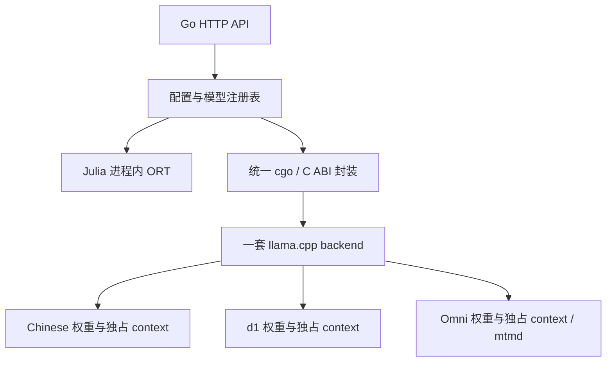

# 统一进程内多模型配置与路由

状态：修订设计，尚未实施。替代已撤回的混合接入方案。用户已决定统一 Go＋cgo、单进程部署；修改配置后重启，只加载启用项，请求可以选择已启用模型。下文 JSON 结构、队列和错误语义是本次工程提议。

## 当前缺口和实施边界

现有 `cmd/ods/main.go` 启动时只构建一个 engine，`decision.ParseForModel` 使用单一模型限制。Chinese 的 `nativeOwned` 保护每个进程只打开一个 native engine；不能直接把几个现有 engine 放进 map，就宣布支持多个 llama 模型。d1 已做 GGUF 实验，尚无生产进程内适配。新旧 SDK 的 context ABI 不同，必须用新头文件重编译。

本轮的数值兼容补丁和报告见 [候选 SDK 验证](../../../tests/evaluation/results/2026-10-28-chinese-parity-fix/README.md)。候选默认路径的验收，与生产引擎升级、多模型生命周期、Omni 输入验收是分别需要完成的步骤。现有 SDK 身份保护不得绕过；实验 HTTP server 只作对照，不进入产品部署。

## 部署与所有权



统一的是原生调用边界和部署方式。模型内部保留各自的提示、候选标签、校准和媒体处理；不能把 Chinese 的 A–Z 模板直接套给 d1。

将 backend 的初始化、设备发现、SDK 身份核验和最终释放提取到一个共享 runtime。每个启用的 llama 模型拥有独立 model、context、串行 worker 和有界队列；Omni 另持对应 projector／mtmd context。启动按配置顺序加载、预热，所有启用项成功后才 ready；任一失败释放本次已加载资源并退出，不悄悄少加载一个备用项。

现有 `nativeOwned` 的保护移到共享 runtime 的所有权层，保持一个 backend，不能简单删除保护。第一版所有 llama 作业再经过一个全局设备准入锁，一次只运行一个完整问题，包括媒体编码、decode 和输出复制。各模型的 context 始终独占；并发优化待独立压测后再开。队列长度、已编译 token 和已解码媒体字节均有上限；用完整输入预算拒绝超限请求，不默默截断。

退出时先停止新请求和队列准入，等待在途原生调用结束，再释放各模型的媒体 context、推理 context、权重，最后释放一次 backend。取消请求可以让 Go 调用方提前返回，但 C++ 作业必须持有所有输入和 context 直到 GPU 完成。不能在超时后立即释放它们，也不能运行时卸载 Metal 动态库。

## 配置与请求

建议使用严格 JSON，拒绝未知字段、重复模型 ID、别名冲突和指向禁用项的默认别名。例如以下配置只启用 Chinese；改为同时启用其他模型前需验证设备能容纳全部常驻模型。

```json
{
  "default_model": "decision-primary",
  "aliases": { "decision-primary": "chinese-decision-2b" },
  "native": {
    "sdk_directory": "lib/darwin-arm64/llama-unified",
    "max_active_jobs": 1
  },
  "models": [
    {
      "id": "chinese-decision-2b",
      "adapter": "chinese-decision",
      "enabled": true,
      "artifact_directory": "models/chinese-decision-2b",
      "threads": 4,
      "max_waiting": 32,
      "max_queued_tokens": 65536
    },
    { "id": "d1-2b", "adapter": "liquid-d1", "enabled": false },
    { "id": "d1-omni-2b", "adapter": "liquid-d1-omni", "enabled": false }
  ]
}
```

`sdk_directory` 是将来统一 SDK 的安装位置示意，当前还不存在该生产安装。每个 artifact directory 绑定固定 manifest，包含权重、projector（适用时）、模板、校准配置和 SHA-256。禁止配置任意温度来绕过模型校准或用一个模型的 projector 配另一个权重。SDK 另外绑定源归档、兼容补丁、原生封装版本、头文件及动态库哈希。

启用项必须提供完整配置；禁用项只验证声明结构及 ID／adapter 合法性，不访问其工件文件，不加载模型。相对路径相对配置文件目录解析。首版只接受 `max_active_jobs=1`；其他值启动报错，不能出现无效但被忽略的设置。

请求的 `model` 先解析到已加载实例，再按该实例限制解析题目和媒体。省略时用 `default_model`；允许使用真实模型 ID 或显式别名，响应始终返回实际模型 ID。未知或禁用模型返回404，不支持的模态、题型或超出模型限制返回422，队列预算满返回429。`/v1/models` 只公布已加载项、别名和实际能力，不根据模型名称猜能力。

主模型和备用模型先通过别名手动指定，修改后重启。配置了备用不表示自动重试：自动降级规则、置信度阈值和跨模型分数可比性均未验收，首版不启用。进程启动时只读取一次配置，不提供热切换或逐请求加载卸载。

## 原生边界与模型差异

新增项目自有的 C ABI，向 Go 暴露 opaque runtime／model handle、带版本的配置、同步推理、结果复制和释放。C++ 类型、JSON 库、`std::vector` 和 staging API 不穿过 cgo 边界；异常转为明确错误，不能越过 C ABI。输入标量／字节在同步调用期间借用；若请求提前取消，原生 worker 持有独立副本。输出指针只在复制完成前有效。

Chinese 继续使用已验证模板、A–Z末位 logits、固定温度及独立问题前的 hybrid memory 清理；生产结构化 parser 和长输入金标必须再次通过。

固定 d05706b 的 LFM3 d1 路径在 `tools/server/server-decision.cpp`／`server-context.cpp` 中使用模型模板、候选 label groups、末位 logits 和对应读出。候选组内取最大 logit；choice 用其分布，score 按官方累计概率中位数读出。该路径不能误写成另一类模型的 joint decision-order head，也不能沿用 Chinese 的候选字母映射。官方代码对 LFM3 的短卷积明确禁止跨独立序列混批；首版保持逐问题推理，不能因某个 attention KV API 支持多序列就开放混批。

LFM3 decision 还要求**一整道题的完整 prompt 在一次 physical ubatch 完成**，该路径没有供分块继续使用的 memory。不能复用 Chinese 的512 token分块 decode。首版固定 `n_ctx=n_batch=n_ubatch=8192`，与已测实验一致；在媒体展开后检查文本、图像／音频 token、问题及候选的总长度，超过8192返回422，不截断、不跨 decode 拆分。后续调整该预算必须重新测资源与正确率；实际媒体展开前也需限制输入字节，避免先耗尽内存再拒绝。

d1／Omni 的 C++ 适配从固定官方实现抽取模板渲染、特殊 token 转义、候选映射、媒体插入及读出；逐项与实验 server 冻结输出比对。`server-decision` 当前依赖 server-task／server-common，不能直接整体复制进 Go 服务并声称已脱离 server；需将计算所需模块整理为不监听端口的库。

媒体沿用已验证的官方输入形态：文件中的图像／音频，以及 Omni 问题 instructions 的 `input_audio`。进入推理前校验 MIME、编码、大小、解码后尺寸／时长和实际模型能力。Chinese／Julia 拒绝媒体；d1-2B 仅开放已验收的文本／图像；Omni 的音频问题、音频状态和图像组合分别验收后开放。不得把音频先转文字的降级路径标成原生音频能力。

## 验收与实施顺序

1. 固定源＋补丁 SDK：完整 Chinese 数值门槛及性能对照；仍需真实生产 engine 的结构化 goldens、取消、超长输入和退出验收。通过后升级构建脚本、SDK 身份与默认路径，不以修改 source marker 冒充兼容。
2. 共享 runtime／多模型所有权：重复加载失败回收、禁用项不访问文件、模型队列和全局准入、取消及 drain；先以两个文本模型贯通。
3. d1 进程内适配：相同冻结请求逐题比较模板 token、候选映射、logits、答案和 score 读出；再完整跑504＋485准确率及延迟。
4. Omni／mtmd：冻结图像、音频和组合输入，比较媒体占位、token、答案及概率，检查错误输入和内存上限。补充真实说话人及业务音频集，不能用合成语音小样本认证生产正确率。
5. 配置注册与 HTTP 路由：默认别名、请求选模、能力限制、错误码、全部启用模型就绪和退出。在预计同时启用的模型组合下测内存峰值、排队、单问／多问 p95／p99；不能把单模型原生时间当作端到端 SLA。

指标按真实 model ID 区分排队、拒绝、原生推理、媒体处理、错误和资源占用。主备选择以同一业务集与同场性能结果为依据，不直接比较不同模型未经校准的 confidence。此文档完成设计修订，不表示上述生产实施项已经完成。
